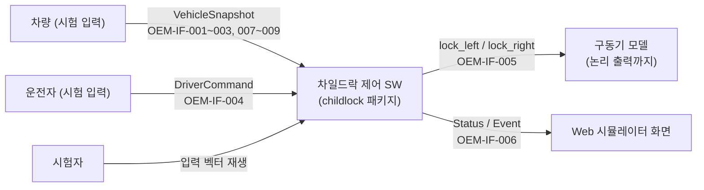
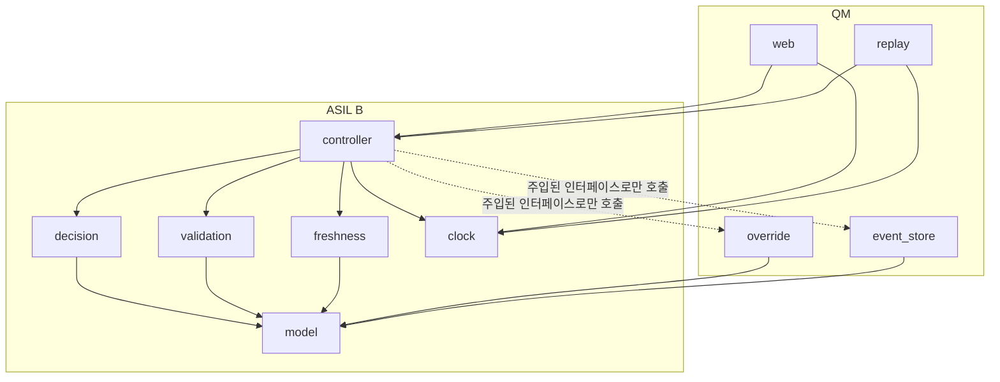
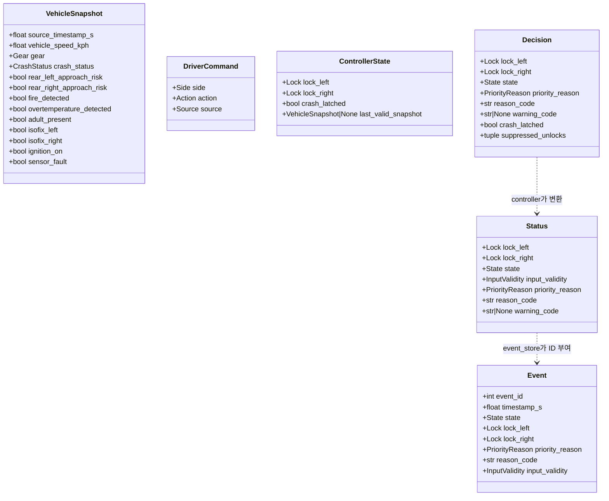
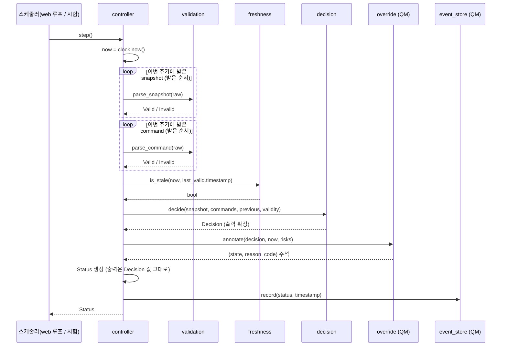
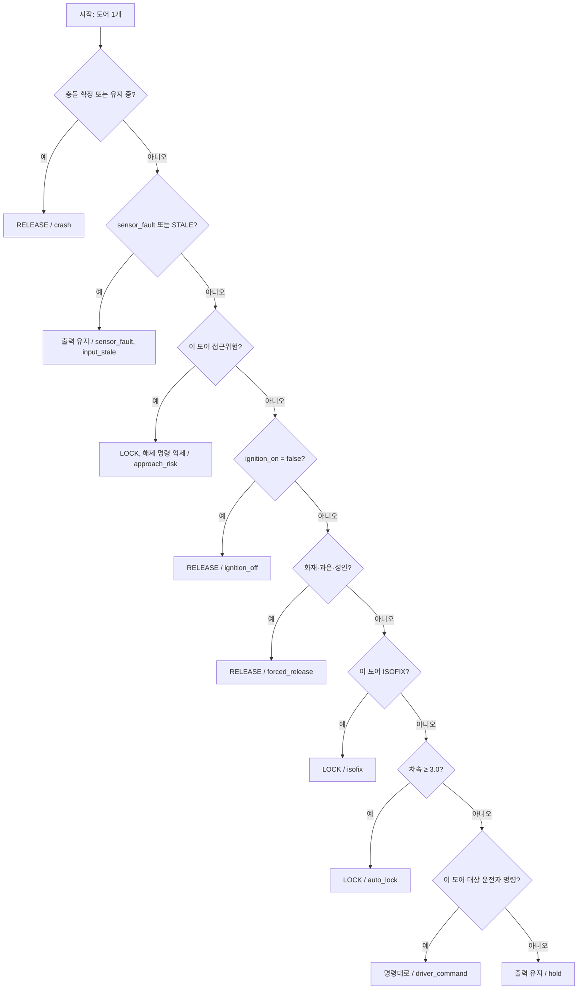
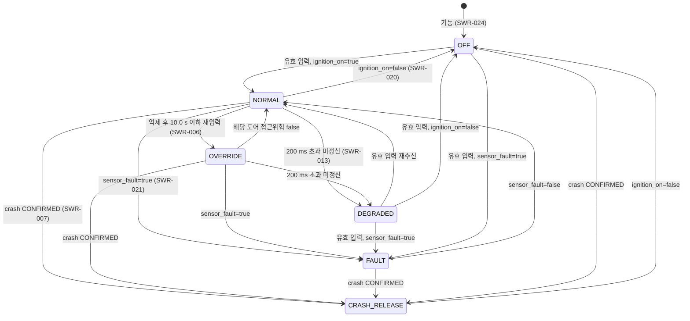

# SWA SW 아키텍처 명세

| 항목 | 내용 |
|---|---|
| 문서 ID | SWA-001 |
| 상위 입력 | BL-SWR-1.0 (`../01_requirements/SWR_SW요구사항명세.md`, `SWIF_SW인터페이스명세.md`) |
| 베이스라인 | BL-SWA-1.0 (G2 승인 대기) |
| 관련 문서 | `SAP_정적분석계획.md`, `TRACE_추적성.md`, `REVIEW_검토기록.md` |

## 1. 목적과 범위

SW 요구사항 23건을 구현할 컴포넌트 구조, 컴포넌트 간 인터페이스, 동적 동작, ASIL B와 QM의 분리 방식을 정한다. 대상은 Python 3.12 PC/SIL 참조 구현과 Web 시뮬레이터이며, 타깃 ECU·RTOS·HIL은 범위 밖이다(OEM-SWR-001 1.3).

## 2. 설계 원칙과 아키텍처 결정

| ID | 결정 | 이유 | 관련 SWR |
|---|---|---|---|
| AD-01 | 판정 로직을 입력·이전 상태 → 새 상태의 **순수 함수**로 만든다 | 같은 입력에 같은 결과(결정론), 시험 용이성, 브랜치 커버리지 100% 달성 | SWR-016, SWR-022 |
| AD-02 | ASIL B 컴포넌트와 QM 컴포넌트를 **모듈로 분리**하고, ASIL B 모듈은 QM 모듈을 import하지 않는다. QM 컴포넌트는 출력(`lock_left`, `lock_right`)을 바꿀 수 있는 인터페이스를 갖지 않는다 | QM 기능이 안전 출력을 바꾸지 못하게 함(간섭 배제). 의존 규칙은 자동 시험으로 검사(SAP 3장) | SWR-005, SWR-006, SWR-007, SWR-013, SWR-021 |
| AD-03 | 시간은 주입형 **시계 인터페이스**(`Clock`)로만 읽는다. 시험은 수동 시계, Web은 실제 시계 | 시간 요구(50 ms, 100 ms, 200 ms, 300 ms, 10 s)를 결정론적으로 검증 | SWR-006, SWR-013, SWR-016, SWR-023 |
| AD-04 | 데이터 객체는 **불변**(frozen dataclass, Enum)으로 만든다 | 컴포넌트가 다른 컴포넌트의 데이터를 몰래 바꾸지 못하게 함 | 전체 |
| AD-05 | 입력 검증 결과는 예외가 아니라 **결과 객체**(유효 값 또는 오류 목록)로 돌려준다 | 무효 입력이 판정 경로를 중단시키지 않음. 처리 흐름이 명시적 | SWR-013 |
| AD-06 | 결정 이력은 `collections.deque(maxlen=100)` 메모리 저장소에만 둔다 | 용량 100건, 휘발성 요구를 표준 자료구조로 충족. 파일 I/O 없음 | SWR-010~012 |
| AD-07 | Web 시뮬레이터는 FastAPI(HTTP JSON API) + 정적 HTML/JS로 만든다 | HTTP 500 요구 충족, 가벼운 구성(D-09) | SWR-014, SWR-015 |
| AD-08 | 평가 주기 실행(스케줄러)과 평가 1회(`step`)를 분리한다 | 시험에서는 `step`을 직접 호출해 주기를 시뮬레이션, Web에서는 50 ms 백그라운드 루프 | SWR-023 |

## 3. 컨텍스트

## 4. 정적 구조

### 4.1 컴포넌트

패키지 `src/childlock/` 아래 모듈 하나가 컴포넌트 하나다.

| 컴포넌트 (모듈) | ASIL | 책임 | 구현 SWR |
|---|---|---|---|
| `model` | B | 공용 데이터 타입: 입력·출력·상태·이유 코드 Enum, VehicleSnapshot, DriverCommand, Decision, Status, Event | 전체 (SWIF) |
| `validation` | B | VehicleSnapshot·DriverCommand 원시 데이터(dict) 검증과 변환 | SWR-013 |
| `freshness` | B | 최신 유효 입력의 freshness 판정(200 ms 초과 여부) | SWR-013 |
| `decision` | B | 좌·우 출력과 state, priority_reason, reason_code 판정. 우선순위 규칙 1~8, 충돌 유지, 접근위험 억제 판정 | SWR-001~005, 007~009, 013, 017, 018, 020~022, 024 |
| `controller` | B | 평가 1회(`step`) 조율: 입력 큐 처리 → 검증 → freshness → 판정 → override 주석 → 이벤트 기록 → 상태 갱신 | SWR-013, SWR-023, SWR-024 |
| `clock` | B | `Clock` 인터페이스, 수동 시계(`ManualClock`), 실제 시계(`MonotonicClock`) | SWR-016, SWR-023 |
| `override` | QM | 접근위험 해제 억제 기록과 10.0 s 이하 재입력 판정. 출력은 다루지 않고 state·reason_code 주석만 반환 | SWR-006 |
| `event_store` | QM | 결정 이벤트 ID 부여, 허용 필드만 저장, 최신 100건 보존 | SWR-010~012 |
| `replay` | QM | 입력 벡터 재생, 공개 결과 해시 계산(시험 지원) | SWR-016 |
| `web` (하위 패키지) | QM | FastAPI 앱, 50 ms 주기 실행 루프, 상태·이력 API, 정적 화면 | SWR-014, SWR-015, SWR-023 |

### 4.2 의존 관계

**의존 규칙** (SAP 3장의 자동 시험으로 검사)
1. ASIL B 모듈(`model`, `validation`, `freshness`, `decision`, `controller`, `clock`)은 QM 모듈을 import하지 않는다.
2. `controller`는 `override`와 `event_store`를 생성자에서 받은 **프로토콜 객체**(`OverrideAnnotator`, `EventSink`)로만 호출한다. 구현체를 import하지 않는다.
3. `decision`, `validation`, `freshness`는 `model`과 표준 라이브러리만 import한다. 입출력, 시계, 전역 상태를 쓰지 않는다.
4. QM 모듈은 ASIL B 모듈의 공개 함수·타입만 쓰고, 내부 상태를 바꾸지 않는다(불변 객체, AD-04).

### 4.3 주요 데이터 타입 (`model`)

Enum: `Lock`(LOCK, RELEASE), `State`(OFF, NORMAL, CRASH_RELEASE, FAULT, DEGRADED, OVERRIDE), `InputValidity`(VALID, INVALID, STALE, NO_DATA), `PriorityReason`(SWIF 5.2), `Side`, `Action`, `Source`, `Gear`, `CrashStatus`. 값과 의미는 SWIF를 따른다.

## 5. 컴포넌트 인터페이스

| 제공 컴포넌트 | 인터페이스 | 입력 | 출력 | 오류 처리 |
|---|---|---|---|---|
| `validation` | `parse_snapshot(raw)` | `Mapping[str, object]` | `Valid[VehicleSnapshot]` 또는 `Invalid(errors)` | 예외 없음(AD-05) |
| `validation` | `parse_command(raw)` | `Mapping[str, object]` | `Valid[DriverCommand]` 또는 `Invalid(errors)` | 예외 없음 |
| `freshness` | `is_stale(now_s, last_timestamp_s)` | 평가 시각, 최신 유효 입력 시각(없으면 None) | `bool` (now − last > 0.200) | — |
| `decision` | `decide(snapshot, commands, previous, input_validity)` | 최신 유효 입력, 이번 주기 유효 명령 목록, 이전 `ControllerState`, 입력 유효성 | `Decision` | 예외 없음(전 경로 정의) |
| `override` | `OverrideAnnotator.annotate(decision, now_s, risk_left, risk_right)` | 판정 결과, 시각, 도어별 접근위험 | `(State, reason_code)` 주석 | 내부 예외는 `controller`가 잡고 주석 없이 진행 |
| `event_store` | `EventSink.record(status, timestamp_s)` / `list_events()` | 상태, 입력 시각 | 없음 / `tuple[Event, ...]` | 내부 예외는 `controller`가 잡고 판정 결과 유지 |
| `controller` | `submit_snapshot(raw)`, `submit_command(raw)` | 원시 입력 | 없음(다음 `step`에서 처리) | — |
| `controller` | `step()` | — (시계에서 시각 읽음) | `Status` | — |
| `controller` | `status()` | — | 최신 `Status` | — |
| `clock` | `Clock.now()` | — | 초 단위 실수 | — |
| `web` | `POST /api/snapshot`, `POST /api/command` | JSON | 202 (접수) / 422 (JSON 구문 오류) | 내용 검증은 `controller.step`에서 수행 |
| `web` | `GET /api/status` | — | 200 JSON(Status) / 500(직렬화 실패) | SWR-015 |
| `web` | `GET /api/events` | — | 200 JSON(Event 목록, 오름차순) | — |

## 6. 동적 동작

### 6.1 평가 1회 (`controller.step`)

- 출력(`lock_left`, `lock_right`)은 `decide`가 돌려준 값으로 확정되고, 그 뒤 단계(override, event_store)는 출력을 바꿀 수 없다(AD-02).
- override 주석은 `decision.state`가 `NORMAL`이고 해당 도어가 접근위험으로 억제된 경우에만 `OVERRIDE`를 붙인다. 더 높은 state(CRASH_RELEASE, FAULT, DEGRADED, OFF)는 덮어쓰지 않는다.
- 무효 입력만 있고 유효 입력이 없는 주기는 `input_validity=INVALID`로 `decide`를 호출하며, `decide`는 출력을 유지한다(SWR-013 ①).

### 6.2 우선순위 판정 (`decision.decide`, 도어별)

입력이 INVALID이거나 아직 없는 주기(NO_DATA)는 규칙을 적용하지 않고 출력을 유지한다(SWR-013, SWR-024). 도어별 판정 뒤 평가 전체의 `priority_reason`·`reason_code`는 두 도어 중 높은 순위 것으로 정한다(SWR-022).

복잡도 10 이하를 지키기 위해 `decide`는 규칙마다 작은 함수(`_rule_crash`, `_rule_hold_on_fault`, … `_rule_driver`)로 나누고, 규칙 목록을 순서대로 적용하는 표 기반 구조로 만든다(상세 설계에서 확정).

### 6.3 state 전이

그림은 주요 전이만 보인다. 일반 규칙: CRASH_RELEASE가 아닐 때 유효 입력이 들어오면 state는 그 평가에서 적용된 가장 높은 우선순위 규칙(SWR-022)으로 정해진다. sensor_fault → FAULT, ignition_off → OFF, 접근위험 override → OVERRIDE, 그 밖 → NORMAL이다.

DEGRADED에서 CRASH_RELEASE로 바로 가는 전이는 없다. DEGRADED는 유효 입력이 없는 상태이므로 새 충돌 상태를 알 수 없기 때문이다. 이미 CRASH_RELEASE인 상태는 freshness를 잃어도 유지한다(1순위).

## 7. 타이밍과 자원

| 항목 | 설계 | 근거 |
|---|---|---|
| 평가 주기 | 50 ms. Web은 `asyncio` 백그라운드 루프, 시험은 `ManualClock` 50 ms 증가 후 `step()` | SWR-023 |
| SR-001 300 ms | CONFIRMED 수신 후 다음 `step`(최대 50 ms)에서 RELEASE → 여유 250 ms | SWR-007 |
| SR-003 100 ms | 200 ms 초과 시점 후 다음 `step`(최대 50 ms)에서 DEGRADED → 여유 50 ms | SWR-013 |
| `step` 실행 시간 예산 | 5 ms 이하(주기의 10%). 통합 시험에서 측정 | 주기 지연 방지 |
| 메모리 | 이벤트 100건 고정 상한, 입력 큐는 주기마다 비움 | SWR-012 |

PC/SIL 판정은 고정 시계 기준이며 실제 OS 스케줄링 지연은 검증 대상이 아니다(OEM 1.3 범위 밖).

## 8. 오류 처리

| 상황 | 처리 | 관련 SWR |
|---|---|---|
| 무효 VehicleSnapshot | 판정에 쓰지 않음, 출력 유지, INVALID | SWR-013 |
| 무효 DriverCommand | 적용 안 함, `command_invalid` | SWR-013 |
| freshness 상실 | DEGRADED, 출력 유지 | SWR-013 |
| QM 컴포넌트(override, event_store) 내부 예외 | `controller`가 잡아 기록하고 판정 결과(출력)는 그대로 유지 | AD-02 |
| 상태 직렬화 실패 | `web`이 HTTP 500 응답 | SWR-015 |
| JSON 구문 오류(HTTP) | `web`이 HTTP 422 응답, controller로 전달하지 않음 | SWR-013 |

## 9. 배포와 외부 의존성

| 구성 | 내용 |
|---|---|
| 런타임 | Python 3.12 |
| 제품 의존성 | FastAPI 0.165.0, uvicorn 0.54.0 (Web 시뮬레이터만 사용). 판정 코어(ASIL B 모듈)는 표준 라이브러리만 사용 |
| 시험 의존성 | pytest, pytest-cov, httpx 0.28.1(FastAPI 시험 클라이언트) |
| 실행 | `python -m childlock.web` → http://127.0.0.1:8000 |
| SBOM | 구현 단계(G3)에서 `requirements.txt` 기준으로 작성 |

## 10. ASIL B / QM 간섭 배제 근거

| 간섭 유형 | 대책 | 검증 |
|---|---|---|
| QM 코드가 안전 출력을 바꿈 | QM 인터페이스에 출력 변경 수단 없음(override는 state·reason만 반환). 출력은 `decide` 결과로 확정 후 변경 불가(불변 객체) | 단위 시험: override가 어떤 값을 돌려줘도 출력 동일 |
| QM 코드 예외로 안전 판정 중단 | `controller`가 QM 호출을 `try/except`로 감싸고, 판정·출력 갱신을 QM 호출보다 먼저 끝냄 | 단위 시험: 예외를 던지는 QM 대역으로 `step` 실행 |
| QM 모듈에 대한 ASIL B 모듈의 의존 | 의존 규칙(4.2) | 아키텍처 시험: import 검사 |
| 공유 데이터 오염 | 불변 데이터 객체(AD-04) | 정적 분석 + 단위 시험 |
| 타이밍 간섭(QM 처리가 주기를 지연) | `step` 실행 시간 예산 5 ms, 이벤트 저장은 O(1) | 통합 시험에서 측정 |

**한계**: Python 단일 프로세스는 메모리 보호(MPU)나 시간 분할을 제공하지 않는다. 위 대책은 교육용 PC/SIL 범위에서 SW 설계 수준의 간섭 배제 근거이며, 양산 ECU의 FFI 논증을 대신하지 않는다.
